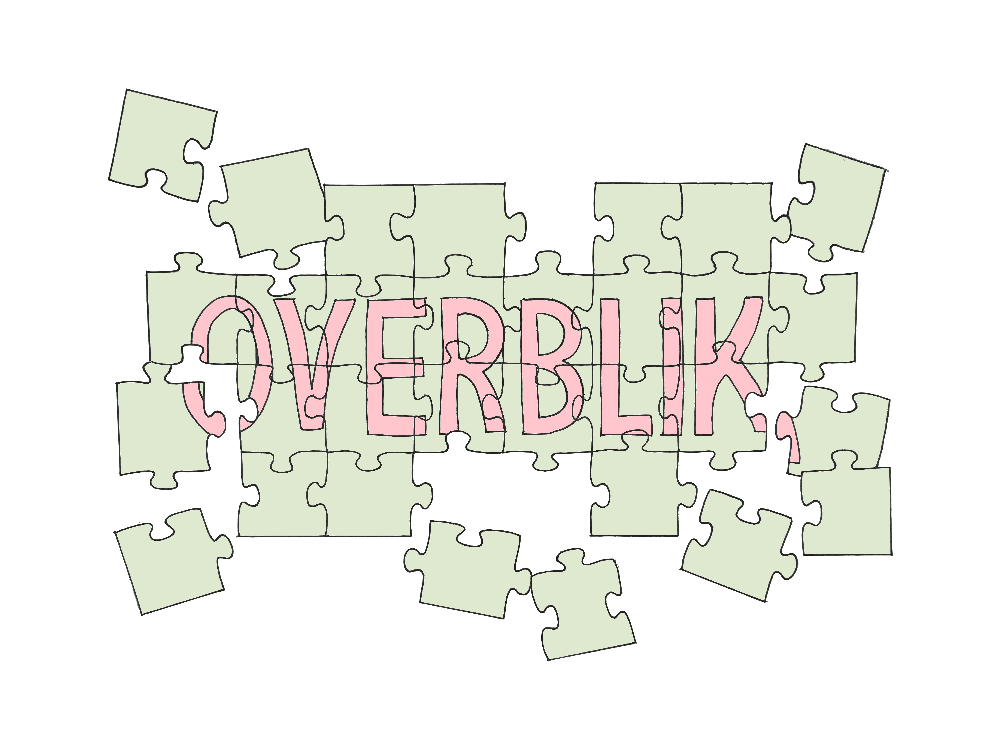

<p align="center">
  
</p>

<p align="center"><b>Less time on admin. More time for the children.</b></p>

<p align="center">
  <a href="https://demo.systematikken.dk">Try the demo</a> ·
  <a href="https://app.systematikken.dk">Open the app</a> ·
  <a href="https://systematikken.dk">systematikken.dk</a>
</p>

Systematikken brings the waiting list, the children and the parents' payments together in one place for Danish private daycare institutions. It is built for managers who don't sit at a computer all day, and it is free.

<p align="center">
  
</p>

## What it does

| | |
|---|---|
| **Waiting list with sign-up** | Parents sign up through a link on the institution's website. Staff see the list in order, offer a place, and parents answer yes or no through a link. |
| **Billing through Betalingsservice** | Prices, half months, free places, sibling discounts, meal scheme and deposit are worked out for you. Approve the month, download the file, send it to Betalingsservice. |
| **Payments and bookkeeping voucher** | Load the bank's payment file to see who has paid. The bookkeeper gets a voucher with the month's figures. |
| **Places month by month** | How many nursery and kindergarten children there are, and when places free up, with children leaving for school counted in. |

## How an institution gets started

1. **Log in** with a Google or Microsoft account. No passwords are stored.
2. **Create the institution** and enter prices and the Betalingsservice agreement.
3. **Share the sign-up link** and enrol the children who attend today.

## Questions

**What does it cost?** Nothing. Systematikken is free and will stay free.

**Where is the data?** On a server in the EU (Helsinki, Finland). Each institution sees only its own data, and waiting-list details are deleted automatically after the time the institution chooses.

**Does it send e-mails to parents?** No. Offers and reminders are written for the staff, who send them from their own mail or phone. Billing goes through Betalingsservice.

**What about CPR numbers?** They are not stored. Billing uses a payment number per child.

---

## For developers

### Run it locally

```
dotnet run --project src/Systematikken.Api    # API on http://localhost:5180
cd web && npm install && npm run dev          # app on http://localhost:5173
```

In development you log in with any e-mail address; no Google or Microsoft setup is needed.

### Layout

| Folder | What |
|---|---|
| `src/Systematikken.Billing` | Pure rules with no database or UI: the fee engine, Betalingsservice files, places report, bookkeeping voucher |
| `src/Systematikken.Api` | ASP.NET Core API on .NET 10, SQLite through EF Core, login with Google/Microsoft. Serves the built React app |
| `web` | React + TypeScript app built with Vite |
| `tests` | Rule tests, and flow tests that run the real API |
| `deploy` | Docker Compose, Caddy and the server setup for Hetzner |

### Specs

- [Fee rules](docs/fee-rules.md)
- [Places report](docs/occupancy-report.md)
- [Bookkeeping voucher](docs/accounting-voucher.md)
- [Betalingsservice files](docs/betalingsservice.md)
- [Running it](docs/operations.md)

## License

[AGPL-3.0](LICENSE). You may use, change and share Systematikken freely. If you run a changed version as a service for others, you must publish your changes under the same license.

Systematikken is made by Klopp Consulting.
